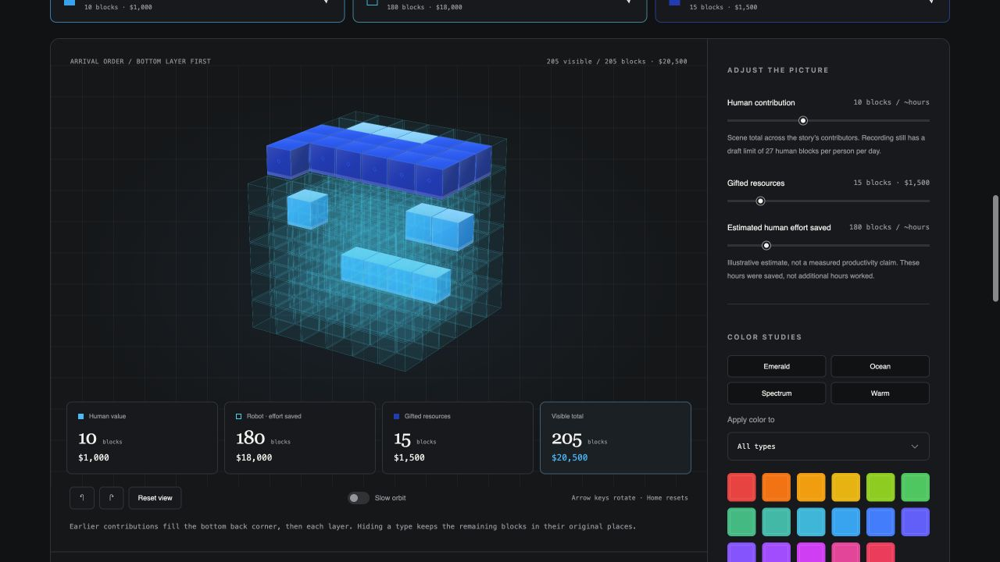
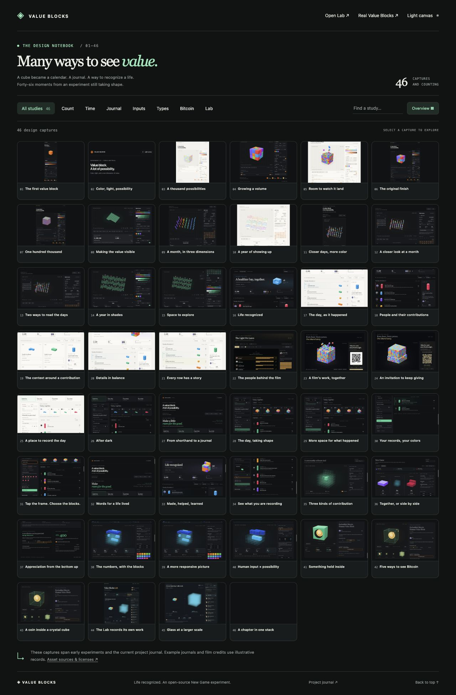

# Value Blocks

**Life recognized.** An open-source visual playground for seeing human effort, care, gifts, and AI-assisted contributions as beautiful, stackable 3D blocks.

**[▶ Open the live playground](https://mullojo.github.io/3d-value-blocks/) · [▦ Explore the design gallery](https://mullojo.github.io/3d-value-blocks/gallery.html)**

Built with Vue 3, Tailwind CSS 4, CSS 3D, and an optional WebGL2 renderer. This is an ongoing New Game economy design experiment: a place to explore visual language and interactions before building the larger systems behind them.



## Run it

Open **[index.html](index.html)** in a modern browser. Everything needed to render the playground is included locally; there is no build step, package installation, account, or backend.

For a consistent browser-storage origin and local preview, run from this directory:

```sh
python3 -m http.server 8317 --bind 127.0.0.1
```

Visit [http://127.0.0.1:8317](http://127.0.0.1:8317). Stop with Ctrl-C. File opening works too, but storage and clipboard support depend on the browser. Records saved at one origin do not automatically appear at another.

## Explore five views

| View | What you can try |
| --- | --- |
| **Count** | Style one cube or build large groups. Explore Tailwind palettes, face shading, edges, rotation, zoom, pan, and paced falling blocks. Keep the original CSS finish or switch to GPU rendering for counts up to 100,000. |
| **Time** | Real calendar layouts for a day, week, month, or year. Explore daily towers, 3×3×3 cubits, compact spacing, and contribution-density gradients. |
| **Journal** | Fictional life and project journals: daily flow, people with stacks, frame stories, and interactive scrolling film credits with a falling-block finale. Click entries for details. |
| **Inputs** | Record, edit, and delete playful local entries using text parsing, row forms, project/team entry, or Tap Select. Watch people’s daily stacks grow. |
| **Types** | Compare human, gift, and robot blocks, filter or restack them, explore project stories and contribution totals, and try embedded-Bitcoin human-block designs. |

The earlier [single-cube](https://mullojo.github.io/3d-value-blocks/archived/v1-simple-start/index.html), [paced CSS](https://mullojo.github.io/3d-value-blocks/archived/v2-paced-css/index.html), and [GPU count](https://mullojo.github.io/3d-value-blocks/archived/v3-gpu-counts/index.html) experiments remain available in `archived/`.

## Design gallery

[Explore all 43 design captures](https://mullojo.github.io/3d-value-blocks/gallery.html): filter by study, search the notebook, or open a full-size image and browse with the arrow keys. The Overview layout gathers every capture into one view. These are historical experiments, including earlier versions of today’s interfaces.

[](https://mullojo.github.io/3d-value-blocks/gallery.html)

The gallery’s images are included locally in `gallery-assets/captures/`, so it works from a file or a static host without relying on a separate folder. See [publishing with GitHub Desktop and GitHub Pages](docs/PUBLISHING.md) to put the playground and gallery online.

## What is a value block?

These are the working conventions behind the examples, rather than a finished economic protocol:

- **Human:** roughly one hour of effort, care, life, or contribution, with a modeled $100 baseline. A daily **cubit** holds up to 27 blocks per person. Recorded examples describe things actually lived or done, usually in the past tense.
- **Gift:** $100 of existing money or resources contributed forward to a frame or project. Darker solids distinguish these from human contributions.
- **Robot:** an estimate of human effort saved through AI or automation, drawn transparently. Three human blocks at a selected 10× expansion produce 30 robot blocks. This estimate is distinct from the original human input.

A journal **entry** groups one or more blocks with one color and tone. A **frame** gives that contribution context, such as Love, Cooperation, or a named project. A life journal can include both life frames and project work; a team journal can focus on one project. Projects can choose a single color family with different work tones, or their own palette.

Types shows contribution estimates together while keeping human hours, robot effort saved, gifts, and appreciation fills distinguishable. Dollar figures are illustrative modeling units, not payments or asset prices. Human and gift appreciation fills can be explored from 1× to 10×; robot blocks do not receive money. Only qualifying human blocks are contemplated as sources of **100 `<G>` Gratitude units** each in the draft New Game protocol.

The [embedded-Bitcoin concept](docs/embedded-bitcoin-human-value-blocks/README.md) explores an optional special human block, including glass cubes with dimensional coins. The playground does not implement wallets, custody, peer approval, minting, or settlement. Film giving and embedded-coin amounts are visual mockups. The real project support address below is separate.

## Local data and performance

Inputs starts with simulated records and saves edits in this browser’s `localStorage`, along with supported palette preferences. You can delete entries or clear them using the input interface. There is no server sync or backup; clearing browser storage removes saved records. Time estimates and overrides are session-only. Names, contributions, movie credits, and affiliations in the examples are fictional; portrait photographs are illustrative.

CSS preserves the detailed original material style for counts up to 1,000. WebGL2 uses exposed-face instancing for larger counts, including the 100,000 preset and full-year scenes. Frame-budgeted preparation, paced arrivals, and cached Types layouts reduce unnecessary work. Performance varies by browser and hardware; 100,000 is a scene-size target, not a frame-rate guarantee. WebGL2 is required for GPU scenes.

## Contribute

Visual experiments, accessibility improvements, browser fixes, performance work, and clearer examples are welcome. See [CONTRIBUTING.md](CONTRIBUTING.md) for the workflow and [the architecture guide](docs/ARCHITECTURE.md) for the code map.

With Node.js 22 or newer, run all local checks without installing packages:

```sh
node scripts/check.cjs
```

The same command is configured for GitHub Actions. Browser visual checks remain important for 3D materials, motion, and interactions; the script checks the models and rendering assumptions, not every browser pixel.

## Support this open-source experiment

Bitcoin giving helps support Value Blocks as an open-source New Game economy project: design exploration, implementation, documentation, and continued experiments in recognizing human value.

**Current project receiving address:**

```text
bc1q5qk0kln078zcky3ylk2axvr69jjrfxewmutwzqcgkvhwhnmtvynsdveyu5
```


Scan with a Bitcoin wallet, or copy the address. No amount is prefilled. See [SUPPORT.md](SUPPORT.md) for the payment URI and verification details. Giving is optional; it does not purchase blocks or promise financial returns, tokens, or draft-protocol eligibility.

## Documentation and license

- [Documentation index](docs/README.md)
- [Architecture and local state](docs/ARCHITECTURE.md)
- [Preserved playground development notes](docs/PLAYGROUND_GUIDE.md)
- [Embedded Bitcoin Human Value Blocks: draft concepts](docs/embedded-bitcoin-human-value-blocks/README.md)
- [Third-party notices and asset sources](THIRD_PARTY_NOTICES.md)

Original project code and documentation are released under the **[MIT License](LICENSE)**. Vendored libraries retain their own notices; illustrative portraits retain the [Unsplash license](https://unsplash.com/license) and are not relicensed under MIT. See the notices before reusing third-party assets.
